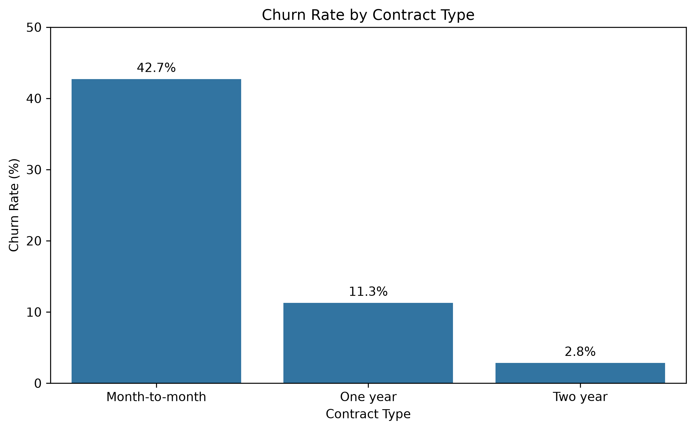
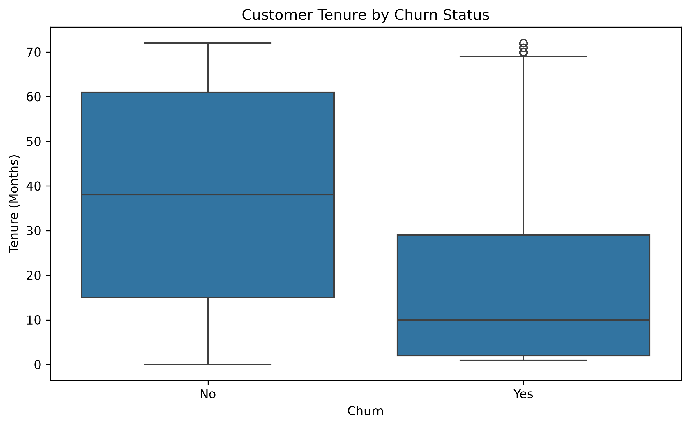
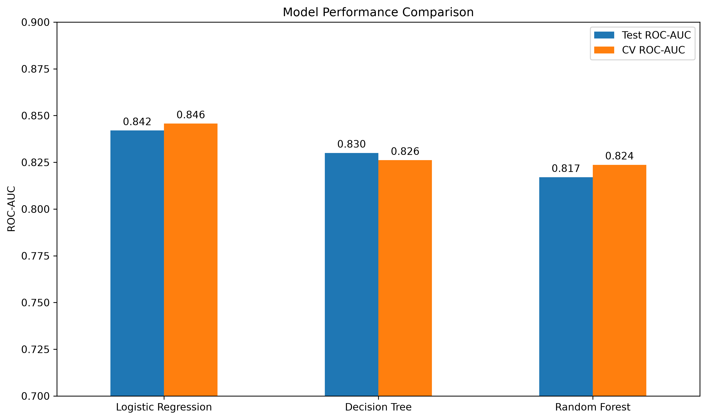
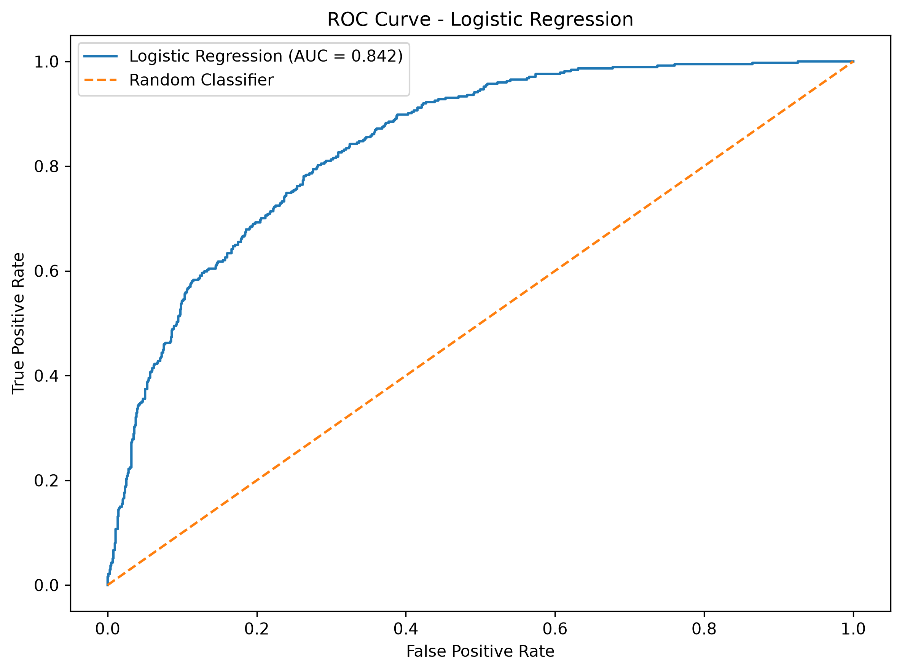
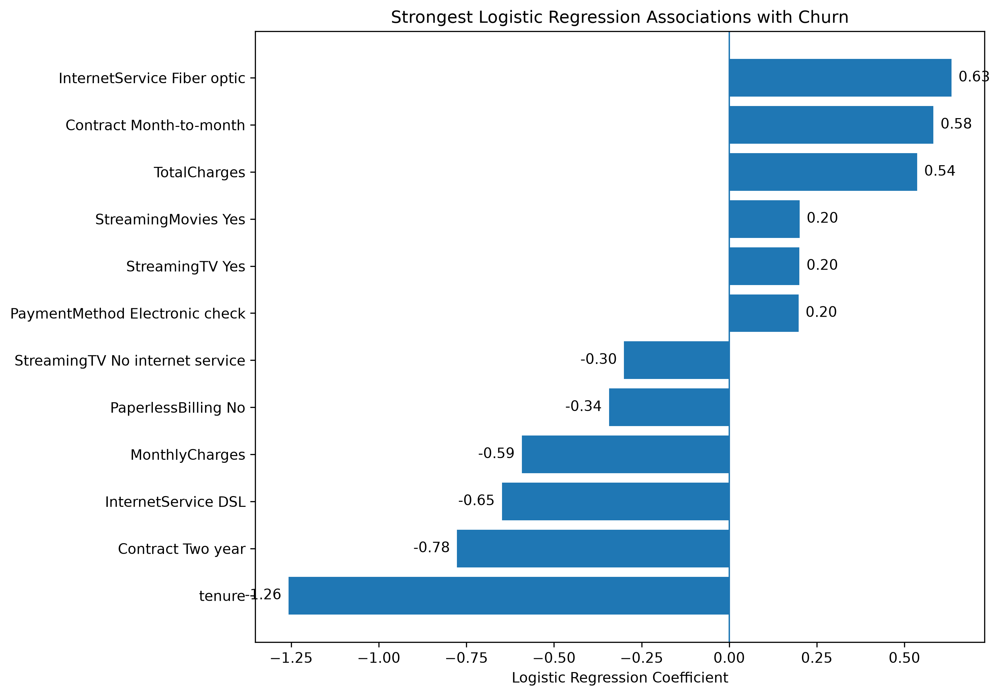

# Customer Churn Prediction

A machine learning project analyzing customer churn in a telecommunications dataset and comparing classification models for identifying customers at risk of leaving.

## Project Overview

Customer churn is an important business problem because retaining existing customers can be more efficient than continuously acquiring new ones.

This project explores customer characteristics associated with churn and develops classification models to predict whether a customer is likely to leave.

The workflow includes:

- Data cleaning and preparation
- Exploratory data analysis (EDA)
- Feature preprocessing
- Logistic Regression, Decision Tree, and Random Forest modeling
- Model evaluation and comparison
- 5-fold cross-validation
- Logistic Regression coefficient interpretation

## Dataset

The dataset contains **7,043 telecommunications customers** and includes information about:

- Customer demographics
- Account tenure
- Internet and phone services
- Contract type
- Payment method
- Monthly and total charges
- Customer churn

The target variable is `Churn`, indicating whether a customer left the company.

## Exploratory Data Analysis

Approximately **26.5% of customers churned**, compared with **73.5% who remained**.

Several customer characteristics showed notable associations with churn.

### Contract Type

| Contract | Churn Rate |
|---|---:|
| Month-to-month | 42.7% |
| One year | 11.3% |
| Two year | 2.8% |

Month-to-month customers showed substantially higher observed churn than customers with longer contracts.



### Customer Tenure

Customers who churned generally had shorter tenure than customers who remained, suggesting that relatively newer customers were more likely to churn in this dataset.



### Internet Service

| Internet Service | Churn Rate |
|---|---:|
| Fiber optic | 41.9% |
| DSL | 19.0% |
| No internet service | 7.4% |

Fiber optic customers had the highest observed churn rate among the three groups.

## Machine Learning

Three classification models were trained using scikit-learn pipelines:

1. Logistic Regression
2. Decision Tree
3. Random Forest

Categorical variables were one-hot encoded and numerical variables were standardized. The data was split into training and test sets using stratified sampling.

## Model Performance

| Model | Accuracy | Precision | Recall | F1 | Test ROC-AUC | CV ROC-AUC |
|---|---:|---:|---:|---:|---:|---:|
| Logistic Regression | 0.806 | 0.657 | 0.559 | 0.604 | **0.842** | **0.846** |
| Decision Tree | 0.798 | 0.635 | 0.567 | 0.599 | 0.830 | 0.826 |
| Random Forest | 0.788 | 0.629 | 0.489 | 0.550 | 0.817 | 0.824 |

Logistic Regression achieved the highest ROC-AUC among the three evaluated models on both the held-out test set and 5-fold cross-validation.



## Logistic Regression ROC Curve

The Logistic Regression model achieved a test ROC-AUC of **0.842**.



## Model Interpretation

The Logistic Regression coefficients were examined to identify characteristics associated with predicted churn.

Notable associations included:

- Shorter tenure associated with higher predicted churn
- Month-to-month contracts associated with higher predicted churn
- Two-year contracts associated with lower predicted churn
- Fiber optic internet associated with higher predicted churn
- Electronic check payment associated with higher predicted churn

These relationships represent associations within the fitted model and should not be interpreted as causal effects.



## Tools

- Python
- pandas
- scikit-learn
- matplotlib
- seaborn
- Jupyter Notebook

## Repository Structure

```text
customer-churn-analysis/
├── data/
│   └── Telco-Customer-Churn.csv
├── figures/
│   ├── churn_distribution.png
│   ├── churn_by_contract_type.png
│   ├── tenure_by_churn.png
│   ├── logistic_regression_roc_curve.png
│   ├── logistic_regression_churn_associations.png
│   └── model_performance_comparison.png
├── notebooks/
│   └── customer_churn_analysis.ipynb
├── README.md
├── requirements.txt
└── .gitignore